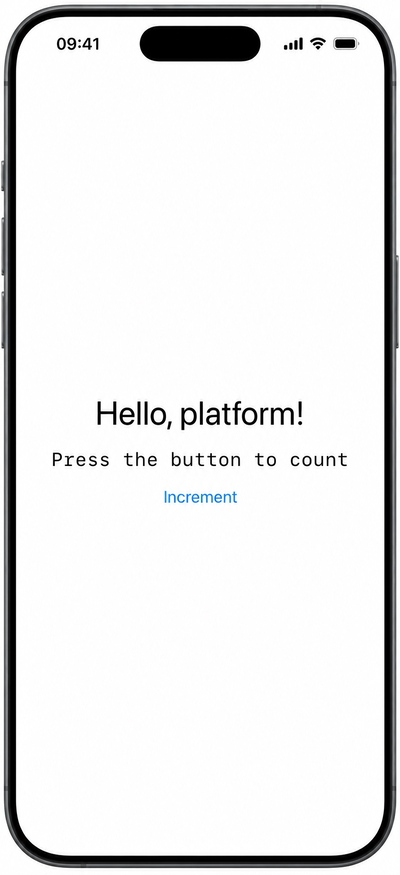

Git Budget allows you to track your spendings and see if you're in the budget

## Components

| Component | Android | iOS | Linux | macOS | Windows | Description | Image |
| --- | --- | --- | --- | --- | --- | --- | --- |
| cui | X | √ | ? | √ | √ | **C**ustom **UI** contains functions to make UI syntax look identical across platforms | N/A |
| hp | ? | √ | ? | √ | √ | **H**ello **p**latform is a simple UI to validate platform support | |
| other | ? | √ | ? | √ | √ | **other** contains generic functions like printing to stderr | N/A |

## Build prerequisites

Git Budget is a cross-platform application with shared logic in Swift
driven by [Dialect](https://github.com/OGStudio/dialect)

### iOS

* Install Xcode 26+
* Install XcodeGen

    `brew install xcodegen`

### macOS

* Install Xcode 26+

### Windows

![Developer mode][w11-dev-mode]

* Install Windows 11
    
    Use x64 Windows if you want to target both Intel and ARM

* Install [Visual Studio 2022 and Swift toolchain][vs]
* Install App Runtime

    `winget install --id Microsoft.WindowsAppRuntime.1.5 -e --source winget`

* Enable developer mode

    Settings -> System -> Advanced -> Developer Mode: On (see the screenshot above)

* Install Git Bash

    `winget install --id Git.Git -e --source winget`

    While in Git Bash installation wizard, select defaults

* Inside Git Bash: configure Git to use actual symlinks

    `git config --global core.symlinks true`

* Inside GitBash: find the location of `swift.exe`

    ```
    $ find /c -name swift.exe 2>/dev/null
    /c/Users/mk/AppData/Local/Programs/Swift/Toolchains/6.4.2+Asserts/usr/bin/swift.exe
    ```

* Inside Git Bash: to `~/.bash_profile` add Swift location (without `swift.exe`) to `PATH`

    `export PATH="$PATH:/c/Users/mk/AppData/Local/Programs/Swift/Toolchains/6.4.2+Asserts/usr/bin"`

* Restart Git Bash

* Make sure Swift compiler is working

    ```
    $ swift --version
    Swift version 6.4.2 (swift-6.4.2-RELEASE)
    Target: x86_64-unknown-windows-msvc
    Build config: +assertions
    ```

[vs]: https://www.swift.org/install/windows/
[w11-dev-mode]: docs/img/w11-dev-mode.jpg
